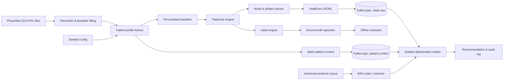

# Clinical Deterioration Copilot - Data Generation

This component creates a reproducible, event-time dataset for the Agentic Clinical Deterioration & Escalation Copilot. It is designed for demonstration and model/system evaluation - **not clinical care, validation, or deployment**.

The generator produces much more than random vital signs:

- Age/sex-stratified baselines fitted from the local PhysioNet Challenge 2019 training set.
- Real, baseline-normalised sepsis-onset windows time-warped into synthetic sepsis-like trajectories.
- Discriminating cases: beta-blocked sepsis, opioid respiratory depression, masked hypoxemia, and COPD low-baseline SpO2.
- Hard negatives: monitoring artifacts, post-physiotherapy, anxiety, and ambulation.
- Benign noisy/transient episodes, so downstream logic must suppress false alarms instead of reacting to one threshold crossing.
- Per-reading trajectory labels and episode-level ground truth, including the first clinically meaningful escalation window.
- Static patient context and a versioned clinical-knowledge corpus ready for a RAG service.
- A stable event envelope suitable for Kafka, file replay, or API ingestion.

## Architecture



### Event and topic contract

| Stream | Kafka topic | Key | Purpose |
| --- | --- | --- | --- |
| Vital readings | `vitals.raw` | `patient_id` | Ordered, event-time patient telemetry |
| Static context | `patient.context` | `patient_id` | Compacted profile available before replay |
| Ground truth | `evaluation.ground_truth` | `episode_id` | Held-out labels for measuring detection and alert burden |
| Knowledge documents | RAG corpus | `document_id` | Versioned, citeable guideline snippets |

All events share `schema_version`, `event_id`, `event_time`, `patient_id`, `source`, and a deterministic `run_id`. The live vital payload contains observed values only. Latent values and labels are deliberately isolated in the evaluation outputs so an agent cannot cheat during demo or testing.

## Dataset construction pipeline

1. Fit age/sex baselines, serial-dependence diagnostics, residual correlation, and real sepsis-onset templates from PhysioNet Challenge 2019 PSV files. Separately fit community HR/BP baselines from CDC NHANES 2017-2018 for hard-negative baseline comparison.
2. Load the versioned fitted parameter artifact, generator configuration, and fixed seed. The generator consumes fitted baselines, real sepsis templates, and OU/correlation estimates through its correlated AR(1) residual-noise process.
3. Sample a static patient profile and derive its baseline from the age/sex stratum.
4. Time-warp a real baseline-normalised window for sepsis-like trajectories; use clearly labelled mechanism-based stress tests for the other archetypes.
5. Add measurement variability and short-lived artifacts. Artifacts can cross a threshold but do not become an episode label.
6. Validate physiology and temporal invariants, write event-time JSONL, then emit separate labels and quality metrics.
7. Replay vital events with their original inter-event timing to Kafka or a local consumer. Publish context first, keyed by patient ID.

This makes the construction pipeline auditable in a midterm report: each signal has a declared source, every synthetic label has a causal scenario, and the seed recreates the exact cohort.

## Quick start

Requires Python 3.10+; the standard generation path has no third-party dependency.

```powershell
python -m clinical_data_gen.cli fit-physionet --input data/training_setA --output data/derived/physionet_2019_params.json
python -m clinical_data_gen.cli fit-nhanes-baselines --bp data/secondary/NHANES_2017_2018_BPX_J.XPT --demographics data/secondary/NHANES_2017_2018_DEMO_J.XPT
python -m clinical_data_gen.cli generate --output data/generated --patients 60 --minutes 180 --seed 20260918 --params data/derived/physionet_2019_params.json --reference data/training_setA --fidelity-max-files 1000
python -m clinical_data_gen.cli validate --input data/generated
python -m clinical_data_gen.cli replay --input data/generated --speed 60
```

To produce Kafka-ready messages, install the optional package and pass brokers:

```powershell
pip install confluent-kafka
python -m clinical_data_gen.cli replay --input data/generated --brokers localhost:9092 --speed 60
```

`--speed 60` sends one minute of simulated time per real second. Without `--brokers`, replay prints the JSONL event envelope to standard output, which makes local integration easy.

## Outputs

```
data/generated/
  manifest.json                 # seed, schema, generation parameters, hashes
  patient_context.jsonl         # compacted/static context
  vitals_observed.jsonl         # only fields permitted to the streaming copilot
  ground_truth_episodes.jsonl   # scenario, onset, escalation window, evidence
  evaluation_labels.jsonl       # held-out event-level labels and latent values
  data_quality_report.json      # invariant/coverage metrics
  knowledge_corpus.jsonl        # RAG-ready protocol snippets
```

## Important design decisions

### Leakage prevention

The live payload intentionally excludes `scenario`, `risk_label`, `latent`, `trend_phase`, and `episode_id`. These are in the evaluator-only files. Keep them in a separate bucket or topic ACL in the full project.

### Clinical realism without claiming clinical validity

Baselines, serial-dependence diagnostics, residual correlation, and sepsis-onset templates are fitted from the local PhysioNet Challenge 2019 training data. The generator consumes fitted baselines, real sepsis templates, and fitted correlated AR(1) residual noise. CDC NHANES 2017-2018 adds an independent community HR/BP baseline reference for hard-negative comparison; it is not used as a deterioration-trajectory source. Medication effects are intentionally not fitted or applied: Challenge-2019 has no medication history or administration field. The additional discriminating archetypes are mechanism-based stress tests, not claims of clinical validation.

### RAG grounding

The corpus includes document ID, source URL, version, and a human-readable locator. It has provenance records for Sepsis-3/qSOFA, NEWS2, and NICE NG51. At alert time, retrieve by vital pattern and cite the document ID, version, and locator in the audit record; local policy and current guidance must govern use.

## Evaluation that makes the demo credible

Report metrics against `ground_truth_episodes.jsonl`, not only a risk score:

- Episode recall and precision within the labelled escalation window.
- Median lead time from first alert to labelled escalation window.
- Alerts per patient-hour and duplicate-alert suppression rate.
- Artifact false-positive rate.
- Retrieval citation coverage and audit-record completeness.
- The generated `data_quality_report.json` records KS distance and lag-1 ACF per channel, real-vs-synthetic correlation error, fitted-versus-realised residual-correlation error, and paired TSTR/TRTR AUROC using patient-level splits. It reports both a deterministic logistic-loss gradient-boosted-stump baseline and stronger depth-3 boosted trees over the five streamed vitals.

Use a patient-level split (not a random row split) so the same profile never appears in both train and evaluation cohorts.

## Project structure

```
src/clinical_data_gen/
  generator.py       # causal trajectory, artifact, labels and validation logic
  fit_physionet.py   # fit PhysioNet parameters and real sepsis templates
  fit_nhanes.py      # fit independent CDC NHANES HR/BP community baselines
  schema.py          # explicit event envelopes and schema version
  cli.py             # generate, validate, replay commands
knowledge/            # versioned RAG corpus seed
config/               # reproducible scenario mix and cadence
tests/                # deterministic and safety/invariant tests
```

## Demo sequence

1. Generate a fixed-seed cohort and show `data_quality_report.json`.
2. Publish contexts, then replay observations into `vitals.raw`.
3. Show an artifact that should be suppressed, then a labelled multi-parameter episode.
4. Let the copilot retrieve the matching protocol snippet and include its ID/version in a recommendation.
5. Compare alerts with the held-out episode window and show the full audit chain.

## Governance

Do not use real patient identifiers. Generated IDs are synthetic. Preserve the manifest, source/config revision, and knowledge-corpus version with every experiment. A clinician should review all scenario assumptions before any use beyond software demonstration.
